# Builder. Yes, I'm a human.

### You run the business. I build the engine under the hood.

AI agents, client-acquisition engines, websites and internal tools, in production for real clients, much of it for Italian law firms.
I design the system, build it with **Claude Code**, **Codex** and **Lovable**, and keep it running with **n8n** and **Make**.
If I mention a tool, I've shipped with it.

  
  
  

<table>
<tr>
<td width="50%" valign="top">

**Studio OS** · the operating system of a law firm 
CRM, matters, team email, document automation, e-signature, invoicing and payments in one app. An AI assistant inside it, plus an MCP server so the firm can work straight from Claude. Designed, built and shipped to production.

</td>
<td width="50%" valign="top">

**An AI agent team** · marketing delivery, a human at the gates 
12 agents run a client's marketing production end to end: research, strategy, ads, copy, SEO, website, landing pages, email. A human approves each gate; the system reviews its own output, retries and tracks cost.

</td>
</tr>
<tr>
<td width="50%" valign="top">

**Acquisition engines** · for 25+ Italian law firms 
Lead-generation campaigns, websites built to convert, quiz funnels, automated intake and nurturing. 16 websites in 3 months, built with AI app builders.

</td>
<td width="50%" valign="top">

**[Team di agenti](https://github.com/alessio-create/team-di-agenti)** · open source 
The kit from my workshop on building your own team of AI agents: Leo, the chief of staff, and his team, ready to install. 
→ [Read the guide](https://team-di-agenti-guida.vercel.app)

</td>
</tr>
<tr>
<td colspan="2" valign="top">

**[Claude Code OS](https://github.com/alessio-create/claude-code-os)** · open source 
The setup I run my own work on. Memory that writes itself at the end of each session, agents that learn from their own mistakes, skills that improve with real use.

</td>
</tr>
<tr>
<td colspan="2" valign="top">

**Also shipped:** **LexIT**, an Italian AI legal assistant grounded in official sources · **Snail**, a visual board app with its own Claude connector · **Claude per Avvocati**, a paid course that teaches lawyers to work with Claude.

</td>
</tr>
</table>

<picture>
  <source media="(prefers-color-scheme: dark)" srcset="https://raw.githubusercontent.com/alessio-create/alessio-create/output/snake-dark.svg">
  
</picture>

The graph above is the receipt. My own setup runs on the same stack I sell: Claude Code as the operating system, 25+ tools connected via MCP, scheduled cloud routines, agents that do the execution. My hours go to judgement and architecture.

  
  
  
  
  
  
  
  
  
  

- **Running system first, talk second.** If I mention a system, there's a working one behind it.
- **I design, machines execute.** I own the architecture; agents and automations do the repeat work.
- **Build in public.** I share what works, what breaks and what it costs.
- **Write it down, then make it true.**

 

> *"No one around me was doing this. I did it anyway."*

**Open for new builds.** Send me the process your team still does by hand every week. [Message me on LinkedIn](https://www.linkedin.com/in/alessiodaleo).
