### I build the systems that make growth happen.

AI agents, client-acquisition engines, websites and internal tools, shipped for real clients.
I design the system, build it with **Claude Code**, **Codex** and **Lovable**, and keep it running with **n8n** and **Make**.
Every tool I talk about, I've put into production first.

  
  
  

## What I've built

<table>
<tr>
<td width="50%" valign="top">

**Studio OS** · an operating system for law firms 
CRM, matters, team email, document automation, e-signature, invoicing, payments, an in-app AI assistant and an MCP server so a firm can work straight from Claude. Designed, built and shipped to production daily.

</td>
<td width="50%" valign="top">

**An AI agent team** · marketing delivery on autopilot 
12 agents that run a client's marketing production end to end: research, strategy, ads, copy, SEO, website, landing pages and email. Human approval gates, automatic review and retry, cost tracking.

</td>
</tr>
<tr>
<td width="50%" valign="top">

**Acquisition engines** · for 25+ Italian law firms 
Lead-generation campaigns, conversion-focused websites, quiz funnels, automated intake and nurturing. 16 websites in 3 months with AI app builders.

</td>
<td width="50%" valign="top">

**[Team di agenti](https://github.com/alessio-create/team-di-agenti)** · open source 
The kit from my workshop on building your own team of AI agents: Leo, the chief of staff, and his team, ready to install. 
→ [Read the guide](https://team-di-agenti-guida.vercel.app)

</td>
</tr>
<tr>
<td colspan="2" valign="top">

**Also shipped:** **LexIT**, an Italian AI legal assistant grounded in official sources · **Snail**, a visual board app with its own Claude connector · **Claude per Avvocati**, a paid course that teaches lawyers to work with Claude.

</td>
</tr>
</table>

## How I build

My own setup runs on AI: Claude Code as the operating system, 25+ tools connected via MCP, 15 scheduled cloud routines and agents that handle the execution. I keep my time for judgement and architecture.

  
  
  
  
  
  
  
  
  
  

## How I work

- **Show the work first.** If I talk about a system, there's a working one behind it.
- **Tools are leverage.** I design the system; agents and automations handle the execution.
- **Build in public.** I share what works, what breaks and what it costs.
- **Write it down, then make it true.**

 

> *"No one around me was doing this. I did it anyway."*

**Open for new builds.** Got a problem nobody around you has solved yet? [Message me on LinkedIn](https://www.linkedin.com/in/alessiodaleo).
